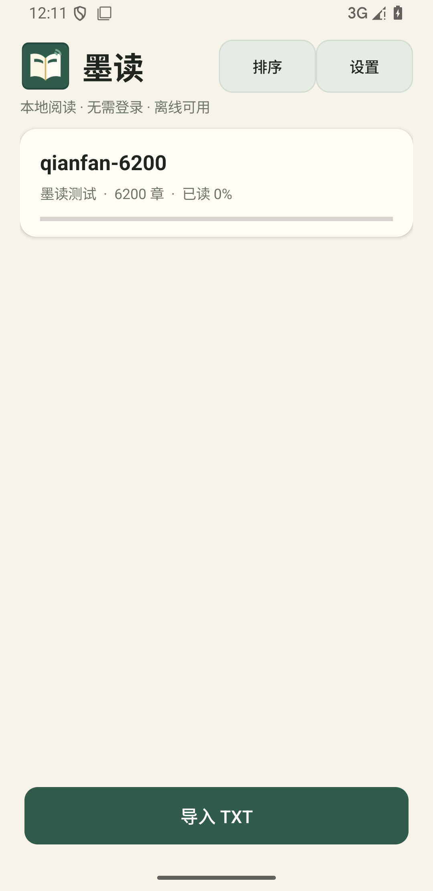
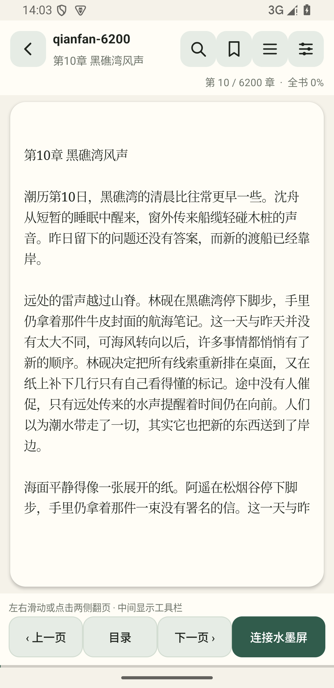

# 墨读 InkReader

一个面向 **华为 552 × 768 四色 NFC 墨水屏手机壳** 的本地 Android TXT
阅读器。安装后直接进入书架，不需要账号，也没有网络功能。

> 这是一个个人学习与非商业项目，不是华为官方应用，也与华为及任何屏幕厂商
> 没有隶属或授权关系。协议部分建立在社区前辈公开的逆向研究之上，详见
> [特别致谢](#特别致谢) 和 [THIRD_PARTY_NOTICES.md](THIRD_PARTY_NOTICES.md)。

当前版本：`0.3.9`

最低系统：Android 8.0（API 26）

目标 SDK：Android 14（API 34）




## 功能

### 本地书架

- 通过系统文件选择器导入一个或多个 TXT 文件。
- 单个文件最大 32 MiB，导入过程在后台执行并显示进度。
- 自动识别 UTF-8、UTF-16、GB18030 和 GBK。
- 识别“第 X 章”“卷 X”“序章”“番外”等常见标题；识别失败时作为“全文”阅读。
- 显示书名、作者、章节数和阅读进度。
- 支持按最近阅读或书名排序。
- 长按删除小说，同时删除章节、书签和阅读进度。
- 使用 SHA-256 检测重复导入。

### 阅读

- 单页阅读，不采用上下滚动。
- 点击正文左侧或右侧翻页；左右滑动翻页；音量键翻页。
- 章末自动进入下一章，目录支持按需加载和当前章节定位。
- 手机与水墨屏使用相同的字符页范围和换行结果。
- 保存章节及页内位置，应用退出、切后台或强制停止后可以恢复。
- 全书搜索，结果显示章节、上下文和高亮关键词；点击直接跳转。
- 书签保存在本地 SQLite，可保存当前页、查看、跳转和长按删除。

### 排版与显示

- 可调字号、行距和左右页边距。
- 可选宋体风格、黑体风格和等宽字体。
- 可选常规或粗体字重。
- 默认排版：黑体 + 粗体、17 sp、1.40 倍行距、16 dp 页边距。
- 支持纸张日间、夜间和护眼背景。
- 支持跟随系统亮度或应用内亮度，以及阅读时常亮。
- 手机屏幕黑幕阅读模式：亮度归零并显示黑色遮罩，音量键继续翻页，亮屏后恢复。

### 华为 NFC 墨水屏

- 保留已验证的 552 × 768 四色图像布局、A0/A1 扫描映射和屏幕配置校验。
- 使用 Shizuku 建立持久 ISO-DEP 会话，不需要 Root。
- 当前页显示后，在后台预传下一页。
- 翻页时优先只发送 D4；预传未命中时才回退为完整 D3 + D4。
- 使用真实 LZO1X 重复串压缩，不发送未压缩像素。
- 真实阅读页测试中，D3 包数从约 476 降至约 55，接近 2 KB 分块方案的理论下限。
- 预传命中时使用更短的 D4 上电等待和忙闲查询间隔。
- 水墨屏页脚显示当前章节/页码、时间和电量。
- 不写入屏幕驱动 DB/DA，继续使用屏幕板内已有驱动。

## 兼容性

水墨屏发送功能要求以下条件同时满足：

1. 手机系统兼容项目验证过的 NXP Q-Poll / QTag 调用。
2. 目标屏幕为相同的 **552 × 768 黑白黄红四色面板**。
3. 屏幕仍使用已验证的原厂扫描配置和板内驱动。
4. 已安装并启动 Shizuku，且向墨读授予权限。
5. 在设置中选择与实物一致的 A0 或 A1 型号。

普通阅读、TXT 导入、书架、搜索、书签和排版设置不需要 NFC、Shizuku
或网络。A0/A1 无法由 D1 自动识别；选择错误可能导致画面排列异常。

不同手机厂商可能限制后台运行、NFC 写入或音量键事件。实际兼容性仍取决于
手机、系统固件和屏幕版本，本项目无法保证所有同名设备都能工作。

## 安装与使用

1. 从 [Releases](https://github.com/pjk2336/huawei-eink-reader/releases)
   下载 APK。
2. 安装后直接进入书架，点击“导入 TXT”选择小说。
3. 如需使用墨水屏，安装并启动 Shizuku。
4. 在“设置 → 手机壳水墨屏”选择实物型号 A0 或 A1。
5. 打开小说，点击“连接水墨屏”，按要求贴合手机壳并保持 NFC 供能。
6. 连接完成后可使用翻页按钮、左右滑动或音量键逐页阅读。

Shizuku 安装与 ADB 启动步骤见 [docs/SHIZUKU.md](docs/SHIZUKU.md)。

## 数据与隐私

- APK 不声明 `INTERNET` 权限，不包含统计、广告或远程同步。
- 小说文件复制到应用私有目录，书架、章节、进度和书签保存在本地 SQLite。
- `allowBackup=false`，不主动参与系统云备份。
- 卸载应用会删除应用私有目录内的全部小说和阅读数据。
- 墨水屏传输需要 Shizuku，但传输只在本机 NFC 与本地服务间进行。

更完整的说明见 [PRIVACY.md](PRIVACY.md)。

## 已知限制

- 水墨屏链路依赖特定系统 NFC 能力和原厂扫描配置，不是通用 NFC 屏幕协议。
- Android 重启后 Shizuku 服务通常需要重新启动。
- 水墨屏刷新耗时受屏幕自身限制；应用已预传下一页，但无法绕过屏幕物理刷新周期。
- 黑幕模式保持 Activity 在前台以接收音量键；若系统锁屏拦截按键，需解锁后继续。
- 部分厂商字体可能将不同字体族映射到同一中文字体，实际字形以系统字体为准。
- 项目目前主要针对手机竖屏和 552 × 768 水墨屏设计。

## 从源码构建

项目不依赖 Gradle，也不会在构建时联网。需要：

- Python 3
- JDK 17+
- Android SDK Platform 34
- Android SDK Build-Tools 34.0.0

在 Windows PowerShell 中：

```powershell
$env:JAVA_HOME = "D:\Android_studio\jbr"
$env:ANDROID_HOME = "C:\Users\<你的用户名>\AppData\Local\Android\Sdk"
python build.py
```

APK 和 SHA-256 会生成在 `dist/`。

离线测试：

```powershell
python tests\run_tests.py
```

测试覆盖屏幕配置校验、A0/A1 布局、图像量化、LZO 压缩、D3 预传/D4
快速翻页以及章节识别。独立 LZO 解码校验使用 MIT 许可的 `lzokay`。

## 项目结构

```text
src/com/inkreader/                阅读器、数据库、分页、设置和 Shizuku 客户端
src/org/nfcresearch/qpolllab/     NFC 面板协议和持久工作进程
res/                              图标与主题资源
assets/licenses/                  随 APK 分发的许可证
libs/                             固定版本 Shizuku API 13.1.5
tests/                            无硬件协议与压缩测试
testdata/                         原创压力测试生成器
docs/                             截图和补充说明
```

详细设计见 [docs/ARCHITECTURE.md](docs/ARCHITECTURE.md)。

## 特别致谢

这个项目首先是站在社区公开研究成果上的 Android 应用整合。协议发现和
原始逆向工作的主要功劳属于以下前辈：

- **氧化钙硼**（社区称呼；Gitee 用户 [@kur0neko](https://gitee.com/kur0neko)）
  对华为墨水屏 PN532/NFC 链路进行了深入逆向，公开了 D3 传图、D4 刷新、
  原厂扫描布局等关键成果。本项目的屏幕传输部分尤其受益于这项工作。
  参考仓库：[huawei-epd-pn532](https://gitee.com/kur0neko/huawei-epd-pn532)。
- **海猫混合物**（GitHub 用户 [@solar2ain](https://github.com/solar2ain)）
  公开了 D8/APDU 定义和 LZO1X 数据格式等资料，为理解协议细节提供了帮助。
  参考仓库：
  [ink-nfc-fmsc-by-pn532](https://github.com/solar2ain/ink-nfc-fmsc-by-pn532)。

同时感谢 [Shizuku](https://shizuku.rikka.app/) 和
[Shizuku API](https://github.com/RikkaApps/Shizuku-API) 提供了免 Root 的高权限
Binder 能力，以及 [lzokay](https://github.com/encounter/lzokay-rs) 提供可参考的
MIT 许可 LZO1X 实现。

这些致谢仅表达感谢，不代表原作者认可、维护或为本项目背书。若你使用了相关
协议成果，也请优先阅读并尊重上游仓库的许可证和说明。

## 许可证

由于包含基于 `kur0neko/huawei-epd-pn532` 的协议实现与布局参考，本项目按
**PolyForm Noncommercial License 1.0.0** 发布，仅允许非商业用途。
继续分发时必须保留许可证、Required Notice 和第三方说明。

第三方组件和具体来源见 [THIRD_PARTY_NOTICES.md](THIRD_PARTY_NOTICES.md)。
